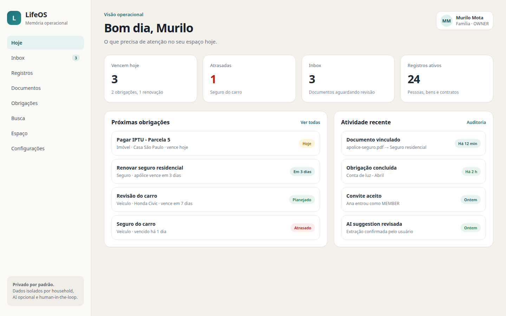
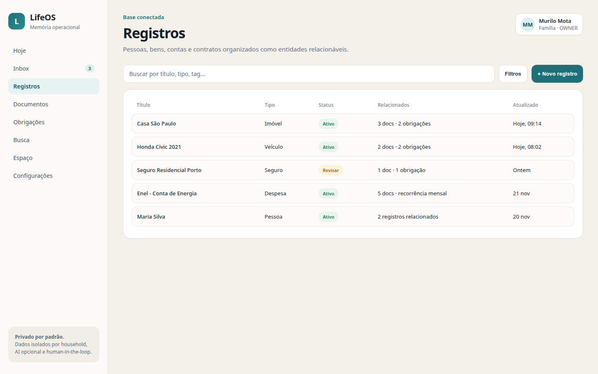
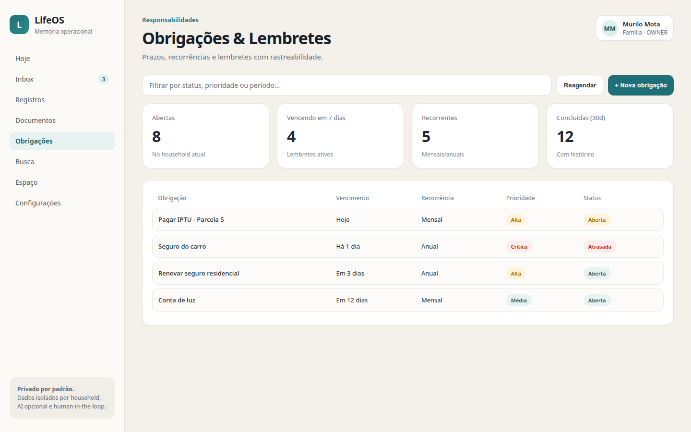
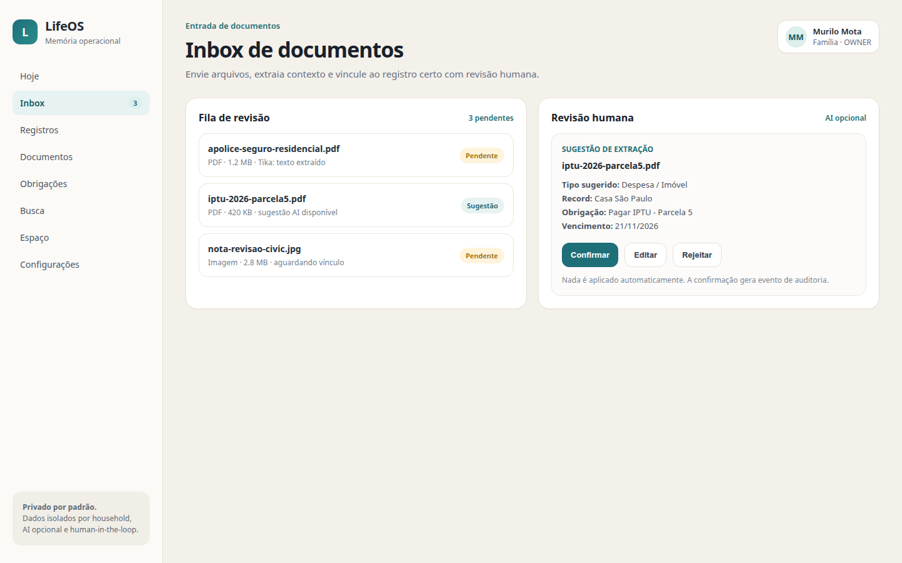
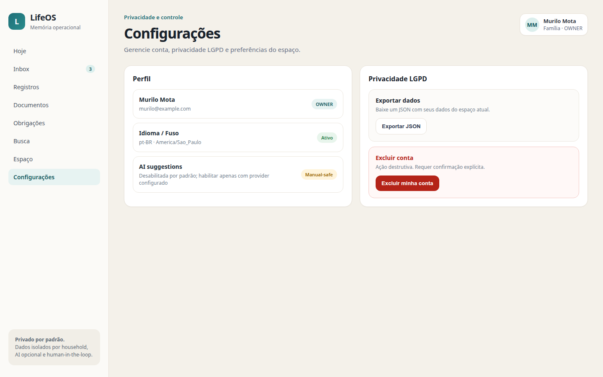
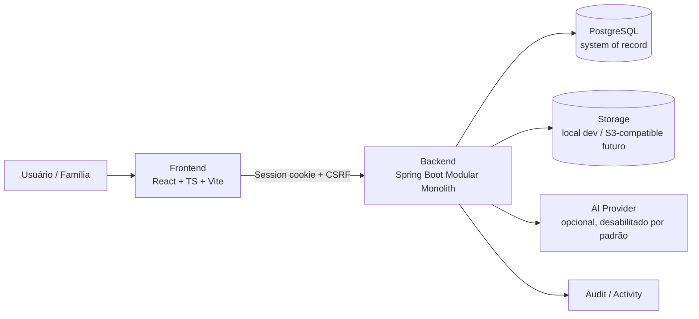

<div align="center">

# LifeOS

**Memória operacional da vida pessoal e familiar.**

Transforme documentos, informações soltas e responsabilidades em registros conectados, prazos claros e ações confiáveis.

[](LICENSE)
[](backend/pom.xml)
[](backend/pom.xml)
[](frontend/package.json)
[](frontend/package.json)
[](docker-compose.yml)

[Visão](#-visão) · [Capturas](#-capturas-do-produto) · [Funcionalidades](#-funcionalidades) · [Arquitetura](#-arquitetura) · [Quick start](#-quick-start-local) · [Contribuir](#-contribuindo)

</div>

---

## Visão

LifeOS é uma plataforma para administração da vida pessoal/familiar. Em vez de espalhar informação em chats, PDFs, e-mails, planilhas e memória humana, o LifeOS organiza o que importa em um sistema confiável:

- **Documentos viram contexto** — uploads entram por uma inbox, podem ser vinculados a registros e ganhar metadados úteis.
- **Informação vira registro** — pessoas, imóveis, veículos, seguros, contas, despesas e itens personalizados ficam estruturados e relacionáveis.
- **Registro vira ação** — obrigações, vencimentos, recorrências e lembretes geram notificações e visão operacional no dashboard.
- **Tudo fica no escopo certo** — dados são isolados por household, com autenticação server-side e autorização no backend.

> O objetivo não é "mais um app de tarefas". É construir uma base privada, conectada e auditável para a vida real.

## Capturas do produto

> Interface baseline do LifeOS (capturas de referência da UI implementada).

| Hoje / Dashboard | Registros |
|---|---|
|  |  |

| Obrigações & Lembretes | Inbox / Revisão humana |
|---|---|
|  |  |

<details>
<summary>Mais capturas</summary>

| Configurações / Privacidade |
|---|
|  |

</details>

## Funcionalidades

| Área | O que já existe | Status |
|---|---|---|
| **Autenticação** | Registro, login/logout, sessão server-side, `/me`, reset de senha (fluxo baseline/manual), household pessoal automático, modo demo sem conta para smoke tests | Baseline |
| **Household** | Membros, convites, aceite/revogação, papéis `OWNER/ADMIN/MEMBER/VIEWER`, gestão administrativa | Baseline |
| **Records** | CRUD, listagem, detalhe, arquivo, relacionamentos, histórico, busca | Baseline |
| **Documentos/Inbox** | Upload, listagem, download autorizado, exclusão, vínculo com record, detecção MIME/Tika, extração de texto | Baseline |
| **Obrigações** | CRUD, completar/cancelar/reagendar, recorrência `DAILY/WEEKLY/MONTHLY/YEARLY`, sync de lembretes, criação de próxima ocorrência | Baseline |
| **Lembretes/Notificações** | Scheduler in-process para lembretes vencidos, dedupe, notificações in-app, marcar lida/todas lidas | Baseline |
| **Dashboard/Search** | Visão "Hoje", resumo operacional, busca global | Baseline |
| **AI (human-in-the-loop)** | Sugestões de extração, revisão/confirmar/rejeitar; **desligada por padrão** até configuração explícita | Baseline seguro |
| **Privacidade/LGPD** | Exportação de dados e exclusão de conta com confirmação na UI | Baseline |
| **Segurança** | CSRF, Argon2id, headers de segurança, rate limit básico por IP, DTO-only, escopo por household | Baseline |

### Limitações conhecidas

- Sem entrega de e-mail para reset/convites e sem canais externos de notificação.
- Scheduler e rate limit são baselines in-process/single-node; produção exige fila durável e limiter distribuído.
- Sem pipeline CI de SAST/dependency/container scan/AV; sem auditoria de segurança externa.
- LGPD baseline não cobre fluxo completo de correção, retenção, backup/restore drill e revisão formal.
- Gate E2E obrigatório e hardening de produção ainda pendentes antes de declarar MVP pronto.

## Arquitetura



### Princípios de design

- **Monólito modular primeiro**: limites claros de domínio sem complexidade prematura de microservices.
- **Household como fronteira de tenant**: toda query de dado sensível é escopada por `household_id`.
- **DTOs, nunca entidades**: a API não expõe JPA entities.
- **AI segura por padrão**: desligada, manual-safe, com revisão humana antes de aplicar sugestões.
- **Privacidade e segurança por padrão**: sem segredos em log, sem ação destrutiva sem confirmação/autorização.

## Stack

| Camada | Tecnologia |
|---|---|
| Frontend | React 18, TypeScript, Vite, Tailwind CSS, React Router, TanStack Query, React Hook Form, Zod |
| Backend | Java 21, Spring Boot 4.1.2, Spring Security, Spring Data JPA, Validation, Actuator |
| Banco | PostgreSQL 16, Flyway |
| Docs/Extração | Springdoc OpenAPI, Apache Tika |
| Testes | JUnit/MockMvc/H2 (backend), Vitest + Testing Library (frontend) |
| Infra local | Docker Compose |

## Estrutura do repositório

```text
LifeOS/
├── .github/                  # CI, templates de issue/PR
├── backend/                  # API Spring Boot (modular monolith)
│   └── src/main/java/com/lifeos/
│       ├── shared/           # segurança, erro, storage, config, time
│       ├── identity/         # auth, usuário, privacidade
│       ├── household/        # household, membership, convites
│       ├── record/           # registros e relacionamentos
│       ├── document/         # documentos, inbox, extração
│       ├── obligation/        # obrigações e recorrência
│       ├── reminder/         # entrega de lembretes
│       ├── notification/     # notificações in-app
│       ├── search/           # busca
│       ├── activity/         # dashboard/auditoria
│       └── ai/               # sugestões AI human-in-the-loop
├── frontend/                 # SPA React
│   └── src/
│       ├── app/              # rotas/layout
│       ├── features/         # fluxos por domínio
│       └── shared/           # api client, tipos, utilitários
├── docs/                     # plano, arquitetura, API, produto, operação
├── docker-compose.yml
└── .env.example
```

## Quick start (local)

### Pré-requisitos

- Java 21+
- Maven 3.9+
- Node 24+ / npm 12+ (ou LTS recente compatível)
- Docker + Docker Compose

### 1) Configurar ambiente

```bash
cp .env.example .env
```

Revise os valores antes de subir qualquer ambiente compartilhado. **Nunca** commite `.env` com segredos reais.

### 2) Subir PostgreSQL

```bash
docker compose up -d postgres
```

### 3) Rodar backend

```bash
cd backend
mvn spring-boot:run -Dspring-boot.run.profiles=local
```

- API: `http://localhost:8080`
- Health: `http://localhost:8080/api/v1/health`
- OpenAPI/Swagger: `http://localhost:8080/swagger-ui.html`

### 4) Rodar frontend

```bash
cd frontend
npm install
npm run dev
```

- App: `http://localhost:5173`
- Smoke rápido: use **"Entrar sem conta (demo)"** na tela de login/cadastro.

## Testes e qualidade

```bash
# Backend
cd backend && mvn test

# Frontend
cd frontend && npm run typecheck
cd frontend && npm run lint
cd frontend && npm run test
cd frontend && npm run build
```

## Documentação

| Documento | Conteúdo |
|---|---|
| [`docs/implementation-plan.md`](docs/implementation-plan.md) | Plano mestre, fases, status e decisões |
| [`docs/architecture/overview.md`](docs/architecture/overview.md) | Visão arquitetural e módulos |
| [`docs/architecture/security.md`](docs/architecture/security.md) | Baseline de segurança e gaps |
| [`docs/api/api-conventions.md`](docs/api/api-conventions.md) | Convenções de API/DTO/erros |
| [`docs/development/setup.md`](docs/development/setup.md) | Setup local |
| [`docs/development/testing.md`](docs/development/testing.md) | Estratégia de testes |
| [`docs/product/mvp-scope.md`](docs/product/mvp-scope.md) | Escopo MVP e pendências |

## Contribuindo

Contribuições são bem-vindas. O projeto já tem licença, CI, templates, labels e issues de longo prazo para onboarding.

1. Leia [`CONTRIBUTING.md`](CONTRIBUTING.md), [`CODE_OF_CONDUCT.md`](CODE_OF_CONDUCT.md) e [`SECURITY.md`](SECURITY.md).
2. Pegue uma issue: [good first issue](https://github.com/omurilomota/LifeOS/issues?q=is%3Aissue+is%3Aopen+label%3A%22good+first+issue%22) ou [help wanted](https://github.com/omurilomota/LifeOS/issues?q=is%3Aissue+is%3Aopen+label%3A%22help+wanted%22).
3. Crie branch a partir de `develop` (`feature/*`, `fix/*`, `docs/*`, `chore/*`).
4. Faça commits pequenos (Gitmoji bem-vindo).
5. Rode testes relevantes e abra PR para `develop`.

## Segurança

Se encontrar uma vulnerabilidade, **não abra issue pública**. Siga [`SECURITY.md`](SECURITY.md) para reporte privado via GitHub Security Advisories.

## Licença

Distribuído sob [GNU Affero General Public License v3.0](LICENSE).

A AGPL-3.0 protege o projeto contra apropriação proprietária closed-source, inclusive quando o software é oferecido como serviço pela rede: modificações disponibilizadas a usuários devem fornecer o código-fonte correspondente. Para uso comercial compatível, contribuições e derivações devem respeitar os termos da licença.
